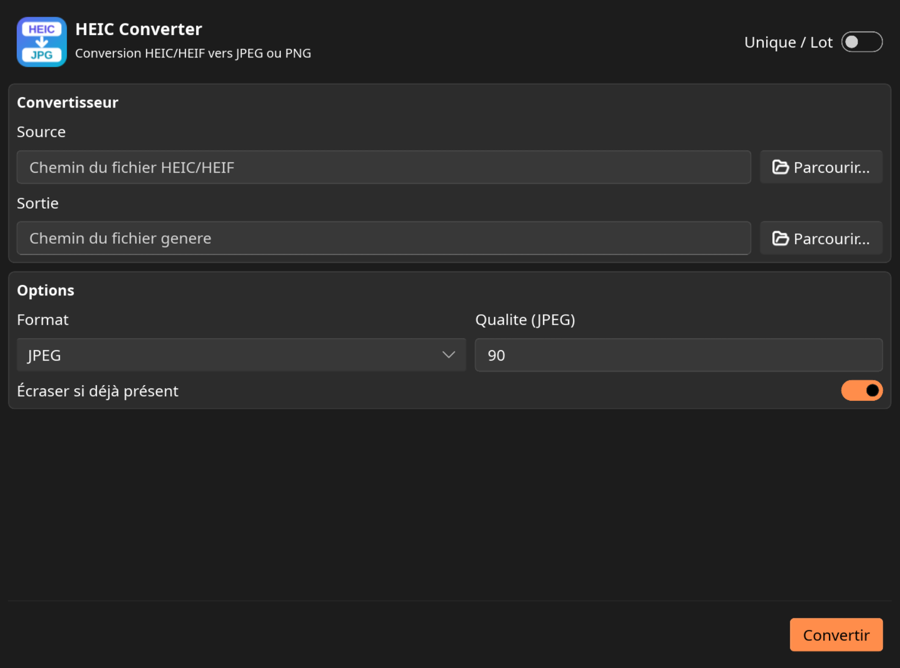

# HEIC Converter

[](LICENSE)

HEIC Converter converts HEIC/HEIF images to JPEG or PNG. It is written in Rust, keeps its conversion core independent from the interface, and provides an optional Slint graphical interface behind the `gui` feature.



## Features

- Convert HEIC/HEIF files to JPEG or PNG.
- Apply orientation and transformation metadata contained in the source file.
- Preserve source dimensions and pixel resolution.
- Convert one file in the graphical interface or process a folder in batch mode.
- Update output file extensions to match the selected JPEG/PNG format.
- Preserve or replace existing output files.
- Show progress feedback, including an indeterminate spinner for single files and a per-file progress bar for batches.
- Open generated files, output folders, and conversion reports.
- Command-line conversion for files and directories, including recursive directory collection.
- Typed error reporting for invalid HEIC input, I/O errors, and excessive image dimensions.

## Artifacts

| Platform | Command-line | Graphical |
|---|---|---|
| Linux | `heic-converter` | `heic-converter-gui` |
| Windows | `heic-converter.exe` | `heic-converter-gui.exe` |

## Installation

### From GitHub

```sh
cargo install --locked --git https://github.com/Franck-Demongin/heic-converter.git --branch main --features gui
```

This builds and installs both `heic-converter` and `heic-converter-gui`. Without `--features gui`, only the command-line binary is installed. On some systems, `~/.cargo/bin` is not on `PATH`; add it to `PATH` or symlink the binaries into `~/.local/bin`.

### From a local checkout

```sh
cargo install --path crates/cli --features gui
```

### Linux build dependencies

The graphical interface needs these development packages on Debian or Ubuntu:

```sh
sudo apt-get update
sudo apt-get install -y build-essential pkg-config \
  libfontconfig-dev libfreetype-dev libx11-dev \
  libxkbcommon-dev libwayland-dev libgl-dev
```

These packages are compile-time dependencies. The installed Linux binaries only link standard runtime libraries.

### Linux desktop integration

After installing the GUI from a local checkout, run:

```sh
packaging/linux/install-local.sh
```

This installs the icon set, a desktop entry, and integrates HEIC Converter into the Linux desktop environment.

## Command-line usage

```sh
heic-converter convert INPUT... --output DIR [OPTIONS]
```

Options:

| Option | Description |
|---|---|
| `--output DIR` | Output directory |
| `--format jpeg,png` | Output format, default: `jpeg` |
| `--quality N` | JPEG quality from 1 to 100, default: 90 |
| `--no-overwrite` | Keep existing output files instead of replacing them |

Examples:

```sh
heic-converter convert photo.heic --output ./output
heic-converter convert ./photos --output ./output --format png
heic-converter convert a.heic b.heic --output ./output --quality 95 --no-overwrite
```

`INPUT` may be one or more files or directories. Directories are scanned recursively for HEIC/HEIF files. Existing output files are replaced unless `--no-overwrite` is used.

## Graphical usage

Start the graphical interface:

```sh
heic-converter-gui
```

During development:

```sh
cargo run -p heic-converter-cli --features gui --bin heic-converter-gui
```

The interface provides two modes:

- **Unique**: convert one HEIC/HEIF file to JPEG or PNG.
- **Lot**: convert every HEIC/HEIF file found directly in a selected source folder.

Available actions include selecting source and output paths, choosing JPEG or PNG, setting JPEG quality, choosing existing-file behavior, monitoring conversion progress, and opening generated files, output folders, or reports.

## Build from source

```sh
cargo build -p heic-converter-cli
cargo build -p heic-converter-cli --features gui --bin heic-converter-gui
cargo build --workspace --all-features
```

## Verification

```sh
cargo fmt --check
cargo clippy --workspace --all-targets --all-features -- -D warnings
cargo test --workspace --all-features
cargo check -p heic-converter-cli
cargo check -p heic-converter-cli --features gui
```

## Project structure

```text
crates/core      # Conversion logic and typed errors
crates/cli       # Command-line entry point and GUI
packaging/linux  # Linux desktop integration
assets/icons     # Application icons
```

## License

HEIC Converter is licensed under `GPL-3.0-or-later`.

The open-source Slint license requires a compatible open-source license. Commercial Slint licenses are required for proprietary distribution.
